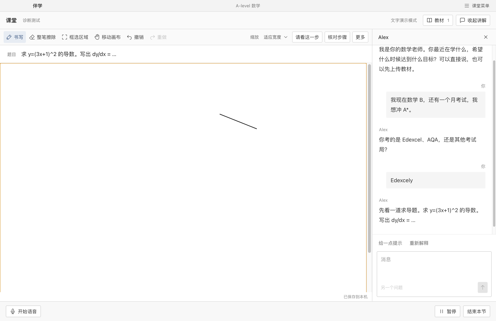

# Banxue 伴学

**你的老师，按你的节奏上课。**

伴学是一款正在开发的 AI 一对一教学软件。

我们想把一对一上课的过程做进软件里：老师能听你提问、看你写的步骤、边讲边写；没跟上时可以随时打断，下次上课接着往下学。

伴学从 A-level 数学开始，把对话、白板、教材和学习记录放在同一间课堂里。代码开放，模型由使用者选择，课堂记录保存在自己的电脑上。



*桌面版演示课堂。图中的题目与对话来自测试数据。*

## 为什么做伴学

伴学的长期目标是教育平权：把一对一辅导的价格打下来，让更多学生能负担持续的帮助。遇到不懂的地方，可以多问几次；一道题没做完，也有时间慢慢来。

我们想把这样的课堂做成人人可以使用、修改和继续开发的软件。代码开放，模型可以自己选，教材和学习记录可以带走。随着项目完善，逐步替换受专有许可限制的组件，让整个工具走向完全开源。

## 现在可以做什么

- **上一节数学课。** 围绕幂函数、链式法则和乘积法则，完成诊断、讲解、练习与复习。可以要提示、请老师重讲，或者暂时换一个话题。
- **在白板上做题。** 写步骤、画图，点击“请看这一步”交给配置的视觉模型查看；也可以把老师的回复放到白板上。新版支持老师逐步添加文字、Unicode 公式、图形、箭头与圈选，保留撤销、恢复和区域导出；当前逐步演示为明确标记的本地固定动作。
- **核对解题区域。** 在“区域识别与核对”中上传区域 PNG，连接自选视觉模型后逐行核对中文、英文与公式，修正歧义和涂改。原图与修改记录保存在本机；当前用固定合成图片验证流程，真实手写识别能力待测。接口与评测见[手写观察](docs/HANDWRITING.md)。
- **带上自己的教材。** 上传 PDF，课堂按需查找相关段落，并保留页码方便回看。
- **接着上次学。** 保存白板、课堂进度和学习记录，下次打开继续。记录和教材可以一起导出。
- **用语音交流。** 已实现千问流式识别、回复和语音播放，以及插话时暂停、取消旧回复的处理。语音配置和复测方法见[语音课堂](docs/QWEN_VOICE.md)。

当前开发版本为 **0.3**。文字课堂、白板和续课已有自动化回归；千问语音已完成适配与模拟接口测试，真实云端调用和真人插话体验正在等待验证。详细结果见[语音验证记录](docs/VOICE_TEST_REPORT.md)。

## 先试一节课

需要 Node.js **22.12+**、Python **3.11+** 和 [uv](https://docs.astral.sh/uv/)。

```bash
git clone https://github.com/sergeymeng/banxue.git
cd banxue
./scripts/dev.sh
```

打开 <http://localhost:3000>。首次启动会安装依赖并创建本地配置；按 `Ctrl+C` 停止。

1. 添加一位 A-level 数学老师，填写学习目标。
2. 上传自己的 PDF，或使用仓库里的 [求导示例教材](samples/derivatives.pdf)。
3. 做几道诊断题，再进入讲解和练习；可以在白板写过程，在对话框提交答案。
4. 结束本节后查看学习记录，下次继续。

默认是无需密钥的演示模式，使用内置教学内容。连接自己的模型后，可以体验生成式讲解与白板视觉观察。

### 桌面版

目前提供 macOS Apple Silicon 的本地构建方式：

```bash
./scripts/build-desktop.sh
```

生成的应用位于 `dist/伴学-darwin-arm64/伴学.app`，内含界面与 Python 服务。模型、密钥和预算在应用的“设置”里填写。构建要求和启动方法见[桌面版说明](docs/DESKTOP.md)。

### 选择模型

第一版语音推荐使用**千问云端**：在桌面设置中选择地域、应用预设，填入自己的 API Key。语音识别、课堂回复与语音合成由云端完成，本机负责录音、语音活动检测和播放。

文字与视觉模型可以分别配置，使用兼容 Chat Completions 的接口。模型地址、名称、密钥和价格都由使用者填写；语音的 ASR、LLM、TTS 也有独立接口，方便继续接入其他服务。

云端模式会把相应语音、课堂上下文或白板图像发给所选供应商，API 费用由自己的账号承担。应用按配置单价估算用量，并支持请求、课堂和每日预算。

完整的模型配置、Docker 启动、本地兼容端点和费用说明见[使用与配置](docs/USAGE.md)。

## 接下来做什么

先把一节课上顺：中文和中英混说能听清，数学表达能读对，学生插话后老师能接住问题。

课堂白板已替换为自研 SVG 实现，并提供逐步动作队列。下一步接入教学动作生成与手写识别，再扩充教材和教学范围。接口与本阶段限制见[白板契约](docs/WHITEBOARD_CONTRACT.md)和[选型说明](docs/WHITEBOARD_DECISION.md)。

## 参与开发

前端使用 Next.js / React，后端使用 FastAPI / SQLite，桌面外壳使用 Electron。教学策略与语言生成分开：策略决定课堂下一步，模型负责表达。代码结构与数据流见 [ARCHITECTURE.md](ARCHITECTURE.md)。

```bash
# 后端测试与静态检查
cd backend
uv sync --frozen
uv run pytest -q
uv run ruff check app tests

# 前端类型检查、单测与构建
cd ../frontend
npm ci
npm run typecheck
npm test
npm run build

# 浏览器集成测试，使用独立的 3100 / 8100 端口和测试数据
npx playwright install chromium
npm run test:e2e

# 桌面设置与权限测试
cd ../desktop
npm ci
npm test
```

如果愿意一起做，可以从语音体验、数学板书、教材处理或白板替换入手。提交问题时附上复现步骤、应用版本和模型名称；涉及课堂内容时使用示例题目即可。

- [使用与配置](docs/USAGE.md)
- [桌面版构建](docs/DESKTOP.md)
- [千问语音接入](docs/QWEN_VOICE.md)
- [评测方法](docs/EVALUATION.md) · [语音验证记录](docs/VOICE_TEST_REPORT.md) · [早期版本测试记录](docs/TEST_REPORT.md)

## 许可

伴学自编代码采用 [MIT](LICENSE) 许可。当前白板使用自研 SVG 实现，已移除 tldraw 运行依赖；历史版本仍受原 SDK 许可约束。其他组件各有许可，不能将整个应用统称 MIT。各组件的许可与原文见[依赖说明](docs/DEPENDENCIES.md)。
