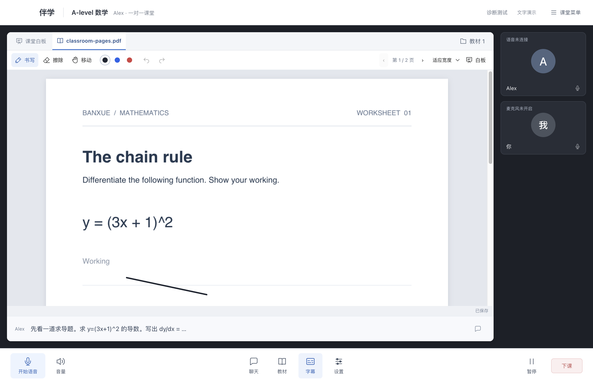
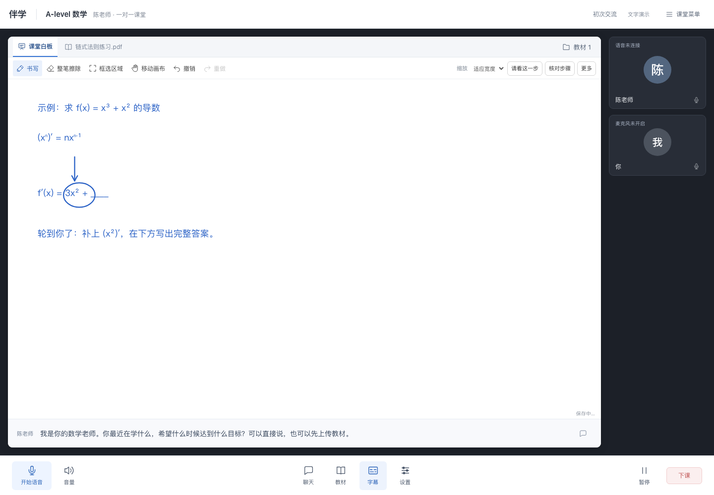
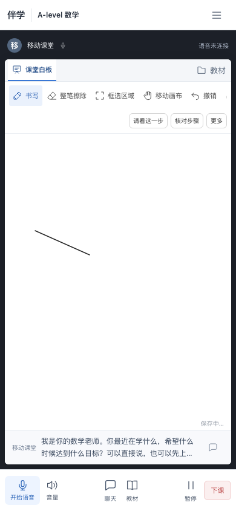

# 会议式课堂交互验收

2026-10-31。共享内容占主画面，师生状态位于侧边，通话控制固定底部。聊天默认收起，当前讲解以可关闭的字幕显示。教材和白板使用页签切换。

## 已实现

- PDF.js 在课堂内渲染实际 PDF；支持逐页书写、三色笔、擦除、撤销重做、缩放和移动。
- 批注按课堂、教材、页码保存；切页、切内容、换老师、下课和应用设置前等待保存。失败时留在当前内容，可重试或导出笔迹。
- 白板与当前教材保持挂载；切换后保留内容。重开课堂恢复最后显示的教材页，重新打开教材可恢复各页笔迹。
- 打开聊天、教材和设置不关闭语音。暂停课堂释放采集与播放，继续上课后恢复连接；音量调节保留插话触发的暂停状态。
- 窄屏把老师状态压缩为顶部状态栏，保留书写空间与底部操作。

## 验证

| 检查 | 结果 |
|---|---|
| 后端 pytest / Ruff | 116 通过；静态检查通过 |
| 前端 TypeScript / Vitest | 通过；39 通过 |
| 浏览器整套 E2E | 14 通过 |
| 保存重试提示修正后的课堂 E2E | 2 通过 |
| 语音仿真 | 16 通过，含暂停后重新连接 |
| Next.js 生产构建 / macOS arm64 打包 | 通过 |
| 桌面设置与权限单测 | 8 通过 |
| 打包应用课堂检查 | PDF 渲染、批注翻页、白板、设置应用、进程重启恢复、鉴权和退出清理通过 |
| 打包应用语音检查 | 本地 VAD/WASM、采集、播放、停止和密钥隔离通过 |

教材测试读取实际 PDF 像素；故障场景注入保存失败，检查笔迹仍在且未跳页。后端覆盖教材归属、页码、笔迹格式、并发版本冲突、丢失回执后的幂等重试、导出与级联删除。

语音测试使用模拟供应商与合成输入，不代表千问真实识别质量或真人扬声器停声延迟。教材批注当前用于书写、保存和导出，尚未接入老师对当前教材笔迹的观察与批改。现有白板观察入口保持独立。

## 实际界面

截图使用合成教材与测试课堂。白板图中的逐步板书来自开发演示动作。

构建产物：`dist/伴学-darwin-arm64/伴学.app`。PDF.js、Worker、字体与 CMap 随应用打包，不依赖 CDN；许可见 [DEPENDENCIES.md](DEPENDENCIES.md)。
